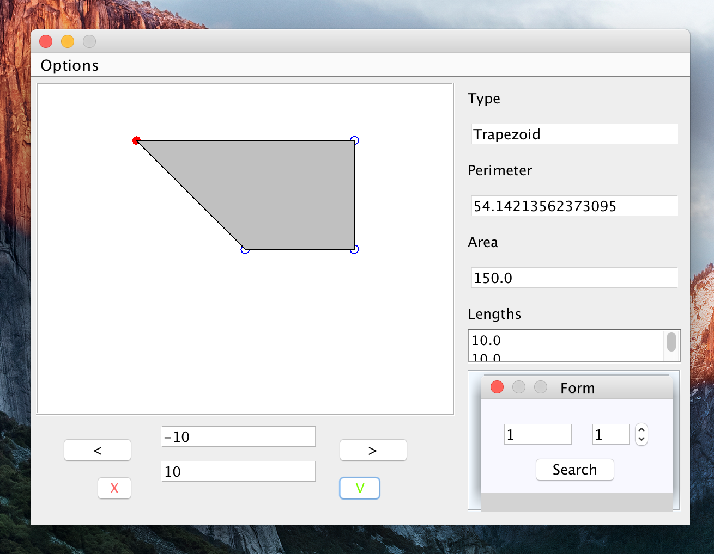

# GeomApp

[](https://github.com/jhumigas/GeomApp/actions/workflows/ci.yml)

A Java application to draw basic geometric shapes.
Using an interface, the user is able to precise points coordinates and the app will get the distance, area and type of figure.

It implements some design patterns very widely used such as MVC, DAO, Observer, Singleton, Factory patterns...

This tiny project was coded using [IntelliJ IDEA](https://www.jetbrains.com/idea/) for an academic purpose: there is no better way to learn programming than getting his own hands dirty.
While learning a programming language, I'd recommend building a GeomApp, a game, or other simple app in that programming language of choice to test yourself.

## Running locally

### Prerequisites

The toolchain is pinned in `.tool-versions` (Java 11, Maven 3.9) for [asdf](https://asdf-vm.com/):

```sh
make setup        # = asdf plugin add java && asdf plugin add maven && asdf install
```

Not using asdf? Any JDK 11+ and Maven 3.8+ on your `PATH` will do.

### Build, test, run

All tasks go through Maven; the `Makefile` wraps the main ones (`make help` lists them):

| Command        | What it does                                        | Maven equivalent        |
|----------------|-----------------------------------------------------|-------------------------|
| `make build`   | Compile the sources                                 | `mvn compile`           |
| `make test`    | Run the unit tests (`src/test/java`)               | `mvn test`              |
| `make run`     | Launch the app from sources                         | `mvn compile exec:java` |
| `make package` | Build a runnable fat jar in `target/`               | `mvn package`           |
| `make run-jar` | Package, then run `java -jar target/geomapp-*.jar`  |                         |
| `make docs`    | Generate the Javadoc in `target/reports/apidocs`    | `mvn javadoc:javadoc`   |
| `make clean`   | Delete `target/`                                    | `mvn clean`             |
| `make db`      | Create `GeomAppDatabase.db` from `GeomAppDatabase.sql` if missing (needs `sqlite3`) |  |
| `make db-reset`| Delete and recreate `GeomAppDatabase.db` from the seed script (drops saved figures) |  |

Run the app from the project root: it opens the SQLite database `GeomAppDatabase.db` from the current directory (and creates the tables if they are missing).

The project follows the standard Maven layout (`src/main/java`, `src/test/java`); IntelliJ imports it directly from `pom.xml`.




## Overview of the architecture

No framework was used to build this project. However the MVC architecture was implemented along with several design patterns. 

There are four main layers corresponding to :

* Persistence
* Business
* Presentation
* Database

### Persistence 

Perform create, read, update and delete [CRUD](https://en.wikipedia.org/wiki/Create,_read,_update_and_delete).

One package implements this layer :
* database : implements the basic layer to interact with the database

This layer relies heavily on the [DAO design pattern](https://www.tutorialspoint.com/design_pattern/data_access_object_pattern.htm).
The GeomAppConnection class only instantiates the connection one time throughout the Application Lifecycle with regard to the [Singleton pattern](https://en.wikipedia.org/wiki/Singleton_pattern).


### Business 

All logic which is tied to the GeomApp is located in this layer.
Basically, the rules to distinguish figures, compute lengths and aeras are implemented here.

The packages to refer to are :
* **model** package which implements basic types of geometric shapes (Rectangular, Trapezoid, Square, Rhombus ,etc)

In a few words, each family of figure relies on a single [factory](https://en.wikipedia.org/wiki/Factory_method_pattern) that takes as input the number of points and their coordinates then knows which sub-type of figure to produce.

### Presentation 

The presentation layer is responsible of the user interface.

* **MVCModel** contains the models used by the views, and links to the business layer
* **MVCViews** implements the User Interface. It relies on the Swing Library
* **MVCController** links the interface to the models 

MVCModel and MVCViews are wired together through an [Observer pattern](https://en.wikipedia.org/wiki/Observer_pattern#cite_note-jont-1) managed by the MVCController package.
Simply put, the model is the observable object, and the view is an observer, updated each time the model is changed.

### Database

This app runs on a SQLite database stored in `GeomAppDatabase.db` (see `GeomAppConnection.java`).
If the tables are missing, they are created on startup and seeded with one square; `GeomAppDatabase.sql` contains the same schema and seed data.
The relational model is described here: 

* **Figure** :  A figure is a geometric shape defined by 
  * id : Primary key
  * type : Type of the figure (e.g Trapezoid)
  * perimeter  : value of the perimeter
  * area : value of the area area
* **Length** : A length or a distance between two points
  * id : Primary key
  * value : Value of the length
  * id_figure : id of the figure to with the corresponding segment belongs to
  * num_length : Number of the segment
* **Point**
  * id : Primary key 
  * x : abscissa of the point (int)
  * y : ordinate of the point (int)
  * id_figure : id of the figure to which the figure belongs too (int)
  * num_point : Number of the point (int)
